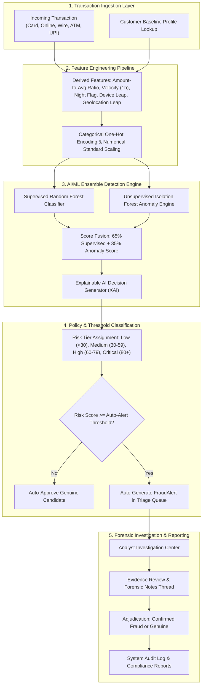

# Intelligent Financial Fraud Detection System
### Enterprise AI/ML Risk Surveillance, Anomaly Detection & Forensic Investigation Platform
**College Final-Year Major Project | Department of Computer Science & Engineering**

---

## 1. Abstract

Modern digital financial architectures process billions of transactions daily across diverse channels, including credit/debit cards, online eCommerce gateways, Real-Time Gross Settlement (RTGS/Wire), Automated Teller Machines (ATM), and Unified Payments Interface (UPI). The unprecedented velocity and scale of digital finance have catalyzed complex cyber fraud mechanisms, including account takeover (ATO), automated card testing bot attacks, nocturnal fund drains, and synthetic identity anomalies. Traditional rule-based rule-engines suffer from rigid decision boundaries, high maintenance overhead, and elevated false-positive rates that disrupt legitimate high-net-worth commerce.

The **Intelligent Financial Fraud Detection System** is an end-to-end, multi-tiered AI/ML risk surveillance platform designed to ingest high-velocity financial transactions, continuously benchmark individual customer spending behavior, detect multi-dimensional anomalous vectors, compute calibrated fraud risk scores (0–100), and generate human-interpretable Explainable AI (XAI) rationale. The platform integrates a supervised **Random Forest Classifier** for known fraud pattern recognition with an unsupervised **Isolation Forest** to uncover zero-day anomalies. Supported by a reactive full-stack architecture (React.js, Node.js/Express, MongoDB/Embedded Storage, and Python FastAPI), the system provides an administrative threat dashboard, interactive fraud triage workspace, customer behavioral profiling, and audit-ready compliance reporting.

---

## 2. Problem Statement

Financial fraud causes tens of billions of dollars in global annual losses. Current transaction monitoring systems face several critical challenges:
1. **High False-Positive Rates (FPR)**: Traditional static rules (e.g., flagging any transaction over $5,000) routinely block legitimate customer purchases, degrading customer trust and burdening fraud investigation units.
2. **Evolving Fraud Modalities**: Cyber criminals continually adapt through distributed botnets, proxy geolocations, and subtle micro-testing patterns that bypass static rule engines.
3. **Black-Box Opacity**: Many advanced deep learning models output raw prediction scores without interpretable explanations, leaving fraud analysts unable to understand *why* a transaction was flagged during time-sensitive investigations.
4. **Lack of Integrated Triage**: Disconnect between automated detection models and the manual adjudication workflows, leading to fragmented audit trails and delayed asset freezes.

---

## 3. Objectives

- **Develop a Multi-Layered AI/ML Fraud Scoring Engine**: Combine supervised ensemble decision trees (Random Forest) and unsupervised anomaly detection (Isolation Forest) into a calibrated risk score (0–100).
- **Behavioral Baselining & Deviation Detection**: Dynamically profile customer spending habits (mean transaction value, peak limits, typical hours, familiar hardware devices, and geolocations) to identify anomalous deviations.
- **Explainable AI (XAI)**: Generate clear, natural-language detection rationales (e.g., *"Transaction amount is 8.5x greater than baseline; simultaneous novel device hardware and midnight execution"*).
- **Analyst Investigation Lifecycle**: Provide an investigation centre allowing fraud analysts to triage pending alerts, inspect digital evidence, add notes, and mark cases as *Confirmed Fraud* or *Genuine*.
- **Executive Threat Analytics & Auditing**: Render interactive charts, vulnerability distributions, date-filtered compliance reports, CSV import/export capabilities, and an immutable system audit trail.

---

## 4. Existing System vs. Proposed System

| Dimension | Existing Conventional System | Proposed Intelligent System |
| :--- | :--- | :--- |
| **Detection Logic** | Hardcoded if-else threshold rules | Supervised Random Forest + Unsupervised Isolation Forest Ensemble |
| **Zero-Day Attacks** | Missed until manual rules are written | Captured via Isolation Forest anomaly isolation |
| **Customer Profiling** | Generic account-type caps | Individualized dynamic spending baselines |
| **False-Positive Handling** | High friction; genuine large transactions blocked | Multi-feature context prevents false alarms on legitimate purchases |
| **Decision Transparency** | Opaque error codes or generic alerts | Human-readable Explainable AI (XAI) decision factors |
| **Investigation Workflow**| Disjointed spreadsheets and legacy ticketing | Real-time interactive triage, notes thread, and automatic transaction synchronization |
| **Architecture** | Monolithic, vendor-locked, high license cost | Modern modular full-stack (React + Express + FastAPI) with zero-cost open-source tools |

---

## 5. Technology Stack

### Frontend
- **Framework**: React.js 18+ initialized with Vite
- **Styling**: Tailwind CSS (Fintech Dark Navy Palette: `#0B0F19`, `#111827`, `#1F293D`, Indigo & Emerald accents)
- **Data Visualizations**: Recharts (Responsive Area Charts, Donut Charts, Bar Charts, Legends, Tooltips)
- **Routing**: React Router DOM v6 with protected routes and role-based clearance
- **Icons**: Lucide React

### Backend
- **Runtime & Framework**: Node.js v20+ / Express.js
- **Architecture**: RESTful API with modular Controller-Service-Repository architecture
- **Security & Authentication**: JSON Web Tokens (JWT), bcryptjs password hashing, Helmet HTTP security headers, CORS origin protection, express-rate-limit
- **CSV Data Processing**: Fast streaming CSV parsing and export generation

### Database & Persistence
- **Primary ODM**: Mongoose ODM with MongoDB Atlas / Local Daemon support
- **Zero-Dependency Dual-Mode Engine**: Built-in automatic fallback to an Embedded In-Memory JSON-backed data engine if MongoDB is not running locally, ensuring 100% out-of-the-box operation on any evaluation laptop.

### Machine Learning Microservice
- **Runtime**: Python 3.12 (managed via `uv`)
- **API Framework**: FastAPI & Uvicorn
- **Algorithms**:
  - `RandomForestClassifier` (Supervised classification with Gini impurity and balanced class weights)
  - `IsolationForest` (Unsupervised anomaly isolation on benign behavioral clusters)
- **Pipelines**: Scikit-Learn `ColumnTransformer`, `StandardScaler`, and `OneHotEncoder`
- **Serialization**: Joblib binary serialization

---

## 6. System Architecture



---

## 7. Module Breakdown

### 1. Main Dashboard & Threat Feed (`/`)
- Real-time KPI metric cards (Total transactions, Suspicious flags, Confirmed fraud, Total value at risk, Fraud detection rate, False-positive rate).
- Four interactive Recharts: 14-day transaction volume vs. suspicious surges, Genuine vs. Confirmed Fraud donut chart, Risk severity bar distribution, and Channel vulnerability chart.
- High-priority real-time alert feed.
- One-click trigger for interactive transaction inference playground.

### 2. Transaction Surveillance (`/transactions`)
- Filterable, searchable, and paginated transaction grid.
- Column sorting across Transaction ID, Amount, Timestamp, and Risk Score.
- Export filtered transactions to CSV.
- Batch CSV dataset upload with schema validation.
- Interactive transaction scoring modal allowing users to test synthetic scenarios.

### 3. Transaction Detail & Explainability (`/transactions/:id`)
- Deep-dive telemetry inspection view.
- Supervised Random Forest probability vs. Isolation Forest anomaly score gauges.
- Natural-language Explainable AI (XAI) evidence points.
- Hardware device fingerprint and geolocation leap checks.
- Customer spending baseline comparison.

### 4. Customer Behavioral Monitoring (`/customers` & `/customers/:id`)
- Directory of synthetic customer profiles.
- Individual customer baseline statistics (average spend, peak spend, typical operating hours, channel preference).
- Automated behavioral deviation alert banners (e.g. sudden high deviation from standard baseline).
- Full historical transaction ledger for each customer.

### 5. Fraud Alerts & Investigation Center (`/alerts` & `/alerts/:id`)
- Triage inbox segmented by status: *All*, *Pending*, *Under Investigation*, and *Resolved*.
- Forensic investigation dossier with one-click claim button.
- Adjudication action controls (*Confirm as Fraud* or *Resolve as Genuine*).
- Automatic synchronization with the underlying transaction record.
- Chronological analyst forensic notes thread.

### 6. Reports & Compliance Analytics (`/reports`)
- Date-range filterable surveillance reports (7 days, 30 days, 90 days, or custom date window).
- Channel fraud incident breakdown table.
- Browser print-ready executive summary layout.
- Export transaction records to CSV.

### 7. ML Model Diagnostics (`/model-performance`)
- Real evaluation metrics computed on a held-out test split (1,500 unseen transactions).
- Precision, Recall, F1-Score, and ROC-AUC score.
- Full 2x2 Confusion Matrix Heatmap (True Negatives, False Positives, False Negatives, True Positives).
- Gini feature importance ranking chart.

### 8. User Management & Audit Logs (`/users` - Admin Only)
- Role assignment and account activation/suspension.
- Forensic audit trail recording user logins, transactions analyzed, alert updates, and system configuration modifications.

### 9. System Threshold Configuration (`/settings`)
- Configurable risk threshold ceilings for Low, Medium, High, and Critical tiers.
- Configurable auto-alert escalation threshold.
- Toggle for nocturnal dormant window flags.

---

## 8. Database Design

```
+-------------------------------------------------------------+
|                            USER                             |
+-------------------------------------------------------------+
| _id          : ObjectId / String                            |
| name         : String                                       |
| email        : String (Unique, Indexed)                     |
| passwordHash : String (Bcrypt Salted Hash)                  |
| role         : String ['admin', 'analyst']                  |
| status       : String ['active', 'suspended']               |
| createdAt    : DateTime                                     |
+-------------------------------------------------------------+

+-------------------------------------------------------------+
|                          CUSTOMER                           |
+-------------------------------------------------------------+
| customerId             : String (Unique, Indexed)           |
| name                   : String                             |
| email                  : String                             |
| phone                  : String                             |
| avgAmount              : Number (Customer Typical Baseline) |
| maxAmount              : Number                             |
| typicalHourRange       : String                             |
| typicalChannels        : Array<String>                      |
| riskProfile            : String ['LOW', 'MEDIUM', 'HIGH']   |
| recentTransactionsCount: Number                             |
| historicalFraudCount   : Number                             |
| primaryLocation        : String                             |
| createdAt              : DateTime                           |
+-------------------------------------------------------------+

+-------------------------------------------------------------+
|                         TRANSACTION                         |
+-------------------------------------------------------------+
| transactionId        : String (Unique, Indexed)             |
| customerId           : String (Indexed)                     |
| amount               : Number                               |
| transactionType      : String ['CARD', 'ONLINE', 'WIRE'...] |
| channel              : String                               |
| timestamp            : DateTime (Indexed)                   |
| merchant             : String                               |
| location             : String                               |
| deviceId             : String                               |
| customerAvgAmount    : Number                               |
| amountToAvgRatio     : Number                               |
| txVelocity1h         : Number                               |
| isNewDevice          : Number [0, 1]                        |
| isNewLocation        : Number [0, 1]                        |
| isNightTx            : Number [0, 1]                        |
| riskScore            : Number (0-100, Indexed)              |
| riskCategory         : String ['LOW', 'MED', 'HIGH', 'CRIT']|
| anomalyScore         : Number (0.0-1.0)                     |
| supervisedProbability: Number (0.0-1.0)                     |
| finalStatus          : String ['Genuine', 'Flagged', ...]   |
| reasons              : Array<String>                        |
| modelVersion         : String                               |
| detector             : String                               |
+-------------------------------------------------------------+

+-------------------------------------------------------------+
|                         FRAUD ALERT                         |
+-------------------------------------------------------------+
| alertId            : String (Unique, Indexed)               |
| transactionId      : String (Indexed)                       |
| customerId         : String (Indexed)                       |
| amount             : Number                                 |
| riskScore          : Number (0-100)                         |
| riskCategory       : String ['LOW', 'MED', 'HIGH', 'CRIT']  |
| reasons            : Array<String>                          |
| assignedAnalyst    : String                                 |
| investigationStatus: String ['Pending', 'Under Inv', 'Done']|
| finalDisposition   : String ['Confirmed Fraud', 'Genuine']  |
| analystNotes       : Array<{ note, author, timestamp }>     |
| resolvedBy         : String                                 |
| resolvedAt         : DateTime                               |
| createdAt          : DateTime                               |
+-------------------------------------------------------------+

+-------------------------------------------------------------+
|                          AUDIT LOG                          |
+-------------------------------------------------------------+
| logId     : String (Unique)                                 |
| actorId   : String                                          |
| actorName : String                                          |
| actorRole : String                                          |
| action    : String ['USER_LOGIN', 'ALERT_UPDATED', ...]     |
| entityType: String                                          |
| entityId  : String                                          |
| timestamp : DateTime                                        |
| details   : Mixed JSON Object                               |
+-------------------------------------------------------------+
```

---

## 9. REST API Documentation

### Authentication
- `POST /api/auth/register` — Register a new security analyst profile.
- `POST /api/auth/login` — Authenticate and receive a signed JWT token.
- `GET /api/auth/me` — Retrieve current authenticated user profile.

### Dashboard & Analytics
- `GET /api/dashboard/summary` — Aggregate KPI metrics, 14-day trends, risk distributions, and system telemetry.

### Transactions
- `GET /api/transactions` — Query paginated transactions with search, risk, channel, status, date, and sorting parameters.
- `GET /api/transactions/:id` — Inspect individual transaction telemetry, feature attributes, and baseline comparisons.
- `POST /api/transactions/analyze` — Run real-time AI risk inference on a synthetic transaction.
- `POST /api/transactions/import` — Ingest and score a batch of transactions via JSON or CSV.
- `GET /api/transactions/export` — Stream transaction records as a downloadable CSV.

### Customers
- `GET /api/customers` — Query customer directory with search and risk filters.
- `GET /api/customers/:id` — Retrieve customer spending profile, analytics, and transaction history.

### Fraud Alerts & Investigations
- `GET /api/alerts` — Fetch triage alerts filtered by investigation status and risk level.
- `GET /api/alerts/:id` — Retrieve full alert case dossier, linked transaction, and customer data.
- `PATCH /api/alerts/:id` — Update alert status, assign analyst, or adjudicate (*Confirmed Fraud* / *Genuine*).
- `POST /api/alerts/:id/notes` — Append a forensic investigation note to the audit trail.

### Reports
- `GET /api/reports/summary` — Generate date-filtered metrics, channel breakdowns, and compliance statistics.

### ML Model Diagnostics
- `GET /api/model/status` — Health and model metadata of the ML inference engine.
- `GET /api/model/metrics` — Empirical evaluation metrics (Precision, Recall, F1, ROC-AUC, Confusion Matrix).

### Administration (Admin Only)
- `GET /api/users` — List authorized security personnel.
- `PATCH /api/users/:id` — Update user status (*active* / *suspended*) or change role.
- `GET /api/audit-logs` — Retrieve immutable forensic audit event ledger.
- `GET /api/settings` — Get current risk thresholds and heuristic switches.
- `PATCH /api/settings` — Update risk score thresholds and escalation policies.

---

## 10. Machine Learning Workflow & Feature Engineering

### 1. Data Preprocessing & Leakage Prevention
Synthetic transaction datasets are partitioned using stratified splitting (75% training, 25% testing) based on fraud ground-truth labels to guarantee that no test vectors influence model training.

### 2. Feature Engineering Pipeline
The system extracts ten high-discrimination features:
- `amount`: Raw currency value.
- `customer_avg_amount`: Customer historical spending mean.
- `amount_to_avg_ratio`: \(\frac{\text{amount}}{\text{customer\_avg\_amount} + 10^{-5}}\).
- `tx_hour`: Time of day (0–23).
- `is_night_tx`: Binary indicator for dormant midnight transactions (12:00 AM – 05:00 AM).
- `tx_velocity_1h`: Transaction frequency in the preceding 60 minutes.
- `is_new_device`: Hardware signature mismatch flag.
- `is_new_location`: Remote IP / foreign geolocation mismatch flag.
- `channel`: One-Hot encoded payment channel (CARD, ONLINE, WIRE_TRANSFER, ATM, UPI).
- `customer_risk_profile`: Categorical customer historical risk tier.

### 3. Model Architecture
1. **Supervised Random Forest Classifier**:
   - 120 decision estimators, max depth 10, balanced class weighting to address typical class imbalance in financial streams.
   - Calculates posterior fraud probability \(P(\text{Fraud} \mid X)\).
2. **Unsupervised Isolation Forest**:
   - 100 isolation trees trained on benign transactions.
   - Calculates normalized anomaly depth \(A(X) \in [0, 1]\), flagging transactions that require unusually few splits to isolate.
3. **Calibrated Ensemble Score**:
   $$\text{Risk Score} = \min\left(100, \max\left(0, \text{round}\left((0.65 \cdot P + 0.35 \cdot A) \times 100\right)\right)\right)$$

### 4. Explainable AI (XAI)
The system inspects feature values and decision boundaries to output natural-language rationale:
- Deviation multipliers exceeding 3.5x customer average.
- Rapid velocity spikes (e.g. \(\ge 6\) transactions/hour).
- Simultaneous hardware and location leap anomalies.
- Unsupervised multi-dimensional outlier alerts.

---

## 11. Installation and Execution Guide

### Prerequisites
- **Node.js**: v18.x or v20+
- **Python**: v3.11+ (or `uv` package manager)
- **Git** (optional)
- *MongoDB*: Optional. The system automatically connects to local MongoDB or MongoDB Atlas if configured, or gracefully switches to the built-in Embedded In-Memory storage engine.

---

### Step 1: Install Dependencies
Open a PowerShell terminal in the project root:
```powershell
# Root dependencies
npm install

# Backend dependencies
cd backend
npm install
cd ..

# Frontend dependencies
cd frontend
npm install
cd ..
```

---

### Step 2: Seed the Database
Populate the database with demo users, 50 customer profiles, and 1,250 realistic transactions spanning the past 30 days:
```powershell
npm run seed
```

---

### Step 3: Train the Machine Learning Models (Optional / Pre-Trained)
Train the Random Forest and Isolation Forest ensemble:
```powershell
npm run train:ml
```
*(Pre-trained model artifacts and empirical metrics are already included in `ml-service/models/`)*

---

### Step 4: Run the Application
You can start all services concurrently with one command:
```powershell
npm run dev
```

Or start services in individual terminal windows:
- **Backend API Server**:
  ```powershell
  npm run start:backend
  ```
  *(Runs on http://localhost:5000)*

- **Frontend User Interface**:
  ```powershell
  npm run start:frontend
  ```
  *(Runs on http://localhost:5173)*

- **Python ML Inference Microservice**:
  ```powershell
  npm run start:ml
  ```
  *(Runs on http://localhost:8000)*

---

## 12. Demo Credentials

The seed script creates two pre-configured accounts for testing:

| Role | Email Address | Password | Clearance Level |
| :--- | :--- | :--- | :--- |
| **Administrator** | `admin@fraudshield.local` | `Admin@123` | Full access (Dashboard, Transactions, Alerts, Reports, Model, Users, Settings) |
| **Fraud Analyst** | `analyst@fraudshield.local` | `Analyst@123` | Investigations access (Dashboard, Transactions, Alerts, Customers, Reports) |

*Tip: The login page includes quick-fill buttons for both roles.*

---

## 13. Testing Instructions

Run the automated test suites:

### 1. Automated Backend & API Tests
```powershell
npm test
```
Executes Jest test suites covering:
- Authentication & JWT token generation.
- Role-based clearance checks (Admin vs Analyst).
- Transaction ingestion, validation, and automated risk scoring.
- Alert generation, note threading, and adjudication synchronization.
- CSV streaming export.

### 2. Frontend Production Build Verification
```powershell
npm run build
```
Verifies complete Vite React build compilation, Tailwind stylesheet generation, and zero bundle errors.

---

## 14. Limitations

1. **Synthetic Data**: In compliance with banking regulations, the system demonstrates algorithms using synthetic behavioral data rather than real cardholder PANs.
2. **Concept Drift**: Financial fraud schemes evolve seasonally; production deployment would require weekly automated retraining schedules.
3. **Network Latency**: Sub-10 millisecond high-frequency transaction gateways require embedded C++/Go inference instead of HTTP REST bridges.

---

## 15. Future Enhancements

- **Graph Neural Networks (GNN)**: Model relational money mule rings and transaction topology across complex account graphs.
- **Biometric Keystroke Dynamics**: Integrate client-side behavioral typing and mouse velocity modeling.
- **WebSocket Streaming Simulation**: Live simulated card swipe feed with real-time push alerts via Socket.IO.
- **Federated Learning**: Enable multi-bank collaborative model training without sharing sensitive customer transaction records.

---

## 16. References

1. Liu, F. T., Ting, K. M., & Zhou, Z. H. (2008). *Isolation Forest*. Eighth IEEE International Conference on Data Mining, 413-422.
2. Breiman, L. (2001). *Random Forests*. Machine Learning, 45(1), 5-32.
3. Bhattacharyya, S., Jha, S., Tharakunnel, K., & Westland, J. C. (2011). *Data mining for credit card fraud: A comparative study*. Decision Support Systems, 50(3), 602-613.
4. Ribeiro, M. T., Singh, S., & Guestrin, C. (2016). *"Why Should I Trust You?": Explaining the Predictions of Any Classifier*. ACM SIGKDD, 1135-1144.

---
**Project Developed by Nikhil Mathew**  
*Intelligent Financial Fraud Detection System — Academic Demonstration Edition*
